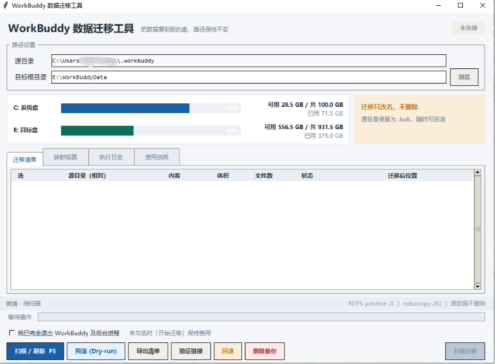
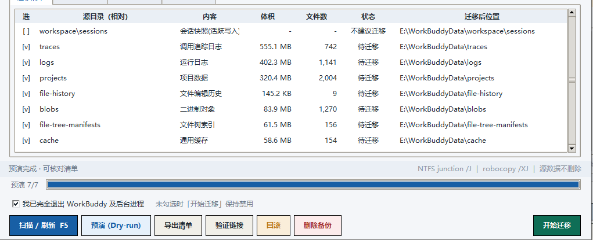
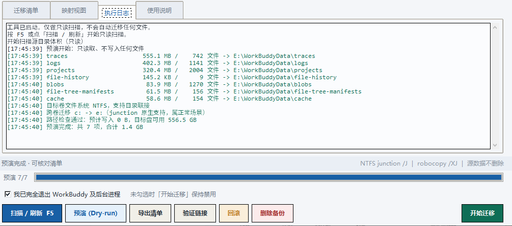
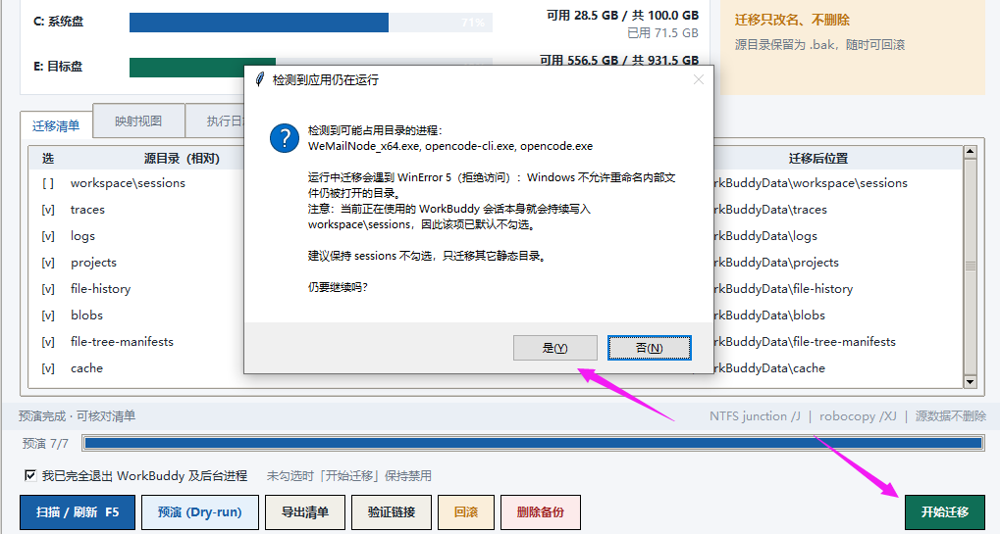
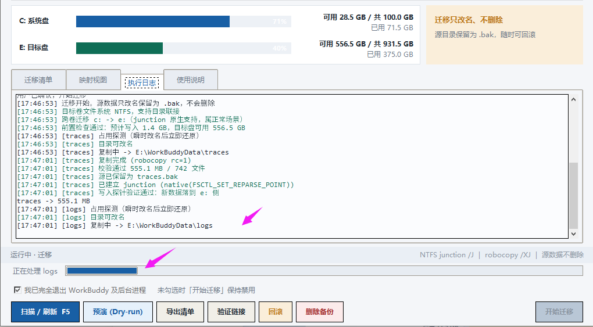
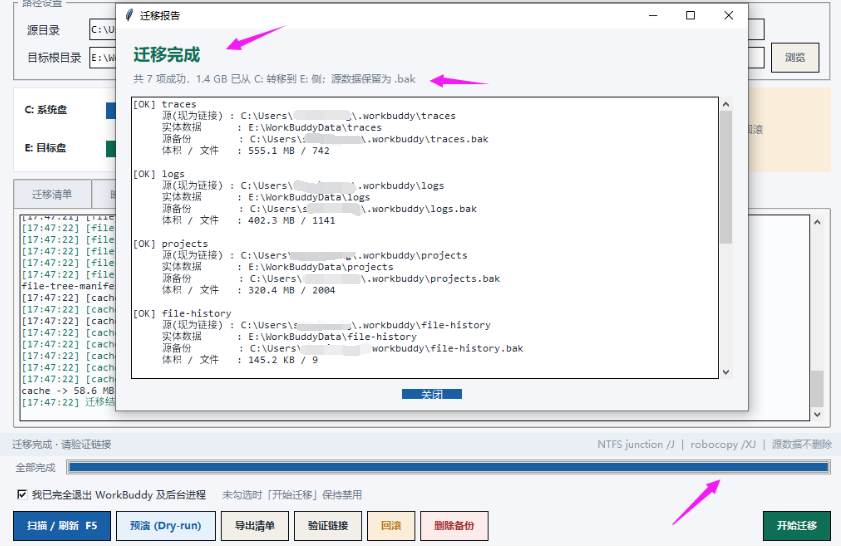

# WorkBuddy 数据迁移工具

> 把 `%USERPROFILE%\.workbuddy` 下体积较大的纯数据目录搬到其它盘，原路径自动变成 NTFS 目录联接（junction）。应用看到的路径完全不变，字节实际落在目标盘。

一个零依赖的 Windows 桌面小工具。单个 Python 文件、Tkinter 图形界面、无需安装任何第三方库、无需管理员权限。



---

## 为什么需要它

WorkBuddy 会把会话快照、调用追踪、运行日志、项目数据、缓存索引等持续写到系统盘下的 `.workbuddy` 目录，用久了容易把 C 盘撑满。直接把目录剪切到别的盘又会破坏应用的路径约定。

本工具的做法是：

1. 把数据目录**复制**到目标盘（默认 `E:\WorkBuddyData`）；
2. 把源目录改名保留为 `<name>.bak`（**绝不删除**）；
3. 在原位置建立一个 NTFS **目录联接**指向目标盘。

结果是：应用照常按原路径读写，源盘侧只剩几百字节的重解析点，新产生的数据自动写入目标盘。

```
C:\Users\<你>\.workbuddy\logs   ──junction──▶   E:\WorkBuddyData\logs
        （路径不变，逻辑目录）                    （实体数据，持续增长）
```

---

## 特性

- **零依赖**：只用 Python 标准库（`tkinter` / `ctypes` / `subprocess`）。
- **免管理员**：优先用 `ctypes` 直接写重解析点，失败自动回退 `mklink /J`。
- **不删源数据**：源目录只改名为 `.bak`，随时可通过界面一键回滚。
- **只动纯数据**：数据库、凭据、`binaries`、`plugins` 等一律留在 C 盘。
- **逐步校验**：复制用 `robocopy /XJ` 排除重解析点，复制后比对字节数与文件数。
- **占用预检**：迁移前先做「瞬时改名再还原」探测，在复制几 GB 之前就发现目录被占用。
- **写入探针**：建链接后实际写一个探针文件，确认新数据确实落到目标盘。
- **失败隔离**：单项失败跳过并继续其它目录，不会留下不一致的链接。
- **安全清理备份**：删除 `.bak` 前逐项校验链接与副本，默认进回收站（可逆）。

---

## 环境要求

| 项目 | 要求 |
| --- | --- |
| 操作系统 | Windows（目录联接仅在 Windows 可用） |
| 文件系统 | 源盘与目标盘均为本地 **NTFS** 卷（不支持 UNC 网络路径） |
| Python | 3.7 及以上，需包含 `tkinter` |
| 权限 | 普通用户即可，无需管理员 |

---

## 快速开始

方式一：双击 `run_migrator.bat`（优先用 `pythonw.exe` 静默启动）。

方式二：命令行运行：

```bat
python workbuddy_migrator.py
```

> 想换目标盘，直接在界面的「目标根目录」里修改或点「浏览」选择即可，不必改代码。

---

## 使用步骤

1. **完全退出 WorkBuddy**，包括托盘图标和后台 `node` / `PortableGit` 子进程。
2. 点「扫描 / 刷新」（快捷键 `F5`）→ 点「预演 (Dry-run)」，核对清单、体积与目标位置。
   `workspace\sessions` 默认不勾选——应用运行期间它必然被占用，保持跳过即可。
3. 勾选「我已完全退出 WorkBuddy 及后台进程」，点「开始迁移」。
4. 完成后点「验证链接」，确认每一项都指向目标盘目录。
5. 重启应用正常使用。稳定运行几天后，可自行决定是否用「删除备份」清理 `.bak`。











---

## 迁移清单

默认迁移以下**纯数据目录**（可在界面中逐项勾选）：

| 相对路径 | 内容 | 分组 |
| --- | --- | --- |
| `workspace\sessions` | 会话快照（活跃写入，默认不勾选） | 会话数据 |
| `traces` | 调用追踪日志 | 日志追踪 |
| `logs` | 运行日志 | 日志追踪 |
| `projects` | 项目数据 | 项目数据 |
| `file-history` | 文件编辑历史 | 缓存索引 |
| `blobs` | 二进制对象 | 缓存索引 |
| `file-tree-manifests` | 文件树索引 | 缓存索引 |
| `cache` | 通用缓存 | 缓存索引 |

**明确不迁移**：顶层所有文件（`workbuddy.db` / `-wal` / `-shm`、`keyblob`、`settings.json`、`mcp.json`、`device-id`）、`binaries`、`plugins`、`app`、`memory`、`security`。

---

## 每一步做了什么

```
robocopy /E /COPY:DAT /DCOPY:DAT /XJ   复制并保留时间戳，排除重解析点
校验 源/目标 的文件数与总字节数         不一致立即停止
rename 源 → 源.bak                     保留原数据，绝不删除
FSCTL_SET_REPARSE_POINT                写 mount point 重解析点（免管理员）
写入探针文件                           验证新数据确实落到目标盘侧
```

---

## 安全与风险

- 删除 junction 时**绝不要**用 `rm -rf` / `Remove-Item -Recurse` / `shutil.rmtree`，它们可能跟随链接把目标盘数据一并删掉。本工具用 `RemoveDirectoryW` 只删链接本身。
- 应用升级或修复安装若删除重建了子目录，链接可能失效，新数据会回流到源盘。升级后请点「验证链接」复查，必要时重建。
- 目录联接只能指向本地 NTFS 卷，不能指向 UNC 网络路径。
- 用 `du` / `Get-ChildItem` 从源盘逻辑路径统计仍会显示「在源盘」，但源盘可用空间不会减少；判断实际占用请看卷剩余空间。
- 删除 junction 目录下的文件，回收站位于目标卷的 `$RECYCLE.BIN`。
- 回滚只恢复源盘侧路径，目标盘副本保留不动。

---

## 常见问题（FAQ）

**Q：迁移时报 `WinError 5 拒绝访问`？**
Windows 不允许重命名内部文件仍被打开的目录。通常是 WorkBuddy 或后台 `node` / `git` 进程仍在运行；`workspace\sessions` 在高频写入，建议保持不勾选，先迁移其它静态目录。

**Q：源盘和目标盘是同一个盘可以吗？**
可以建立 junction，但不会释放该盘空间。界面会给出警告。

**Q：C: → E: 跨盘会报错吗？**
不会，跨卷是标准场景。路径关系判断已做卷感知处理，不会触发 `Paths don't have the same drive`。

**Q：移到回收站后空间没变？**
回收站不会立即释放空间，需要再清空回收站。

**Q：删除 `.bak` 后还能回滚吗？**
不能。此时原路径的链接仍然有效、数据完整保存在目标盘，只是无法一键恢复成迁移前的目录结构。因此「删除备份」会先做逐项安全校验并要求显式确认。

**Q：迁移失败会不会留下坏链接？**
不会。任何一步失败都会跳过该项并保持源目录原样；建链接失败还会自动把 `.bak` 还原回原名。

---

## 项目结构

```
workbuddy-migrator/
├── workbuddy_migrator.py   # 主程序：Win32/NTFS 底层 + 迁移引擎 + Tkinter 界面
├── run_migrator.bat        # 双击启动脚本
├── images/                 # 界面截图
│   ├── 01.png
│   ├── 02.png
│   ├── 03.png
│   ├── 04.png
│   ├── 05.png
│   └── 06.png
└── README.md
```

---

## 免责声明

本工具直接操作 NTFS 目录联接与文件重命名，请务必在理解其原理后使用，并在操作前自行做好重要数据备份。作者不对因误用造成的数据丢失承担责任。
